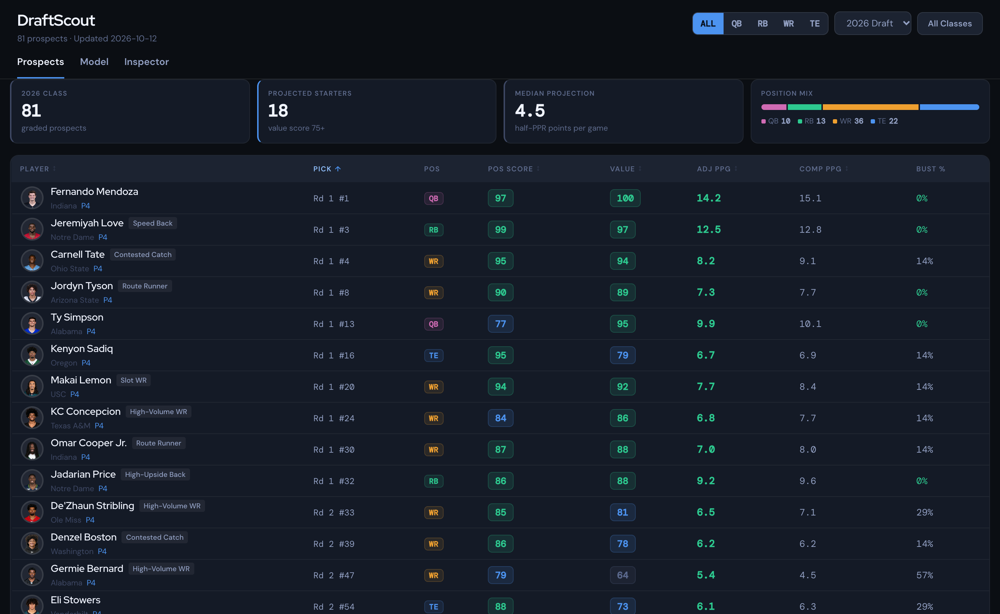
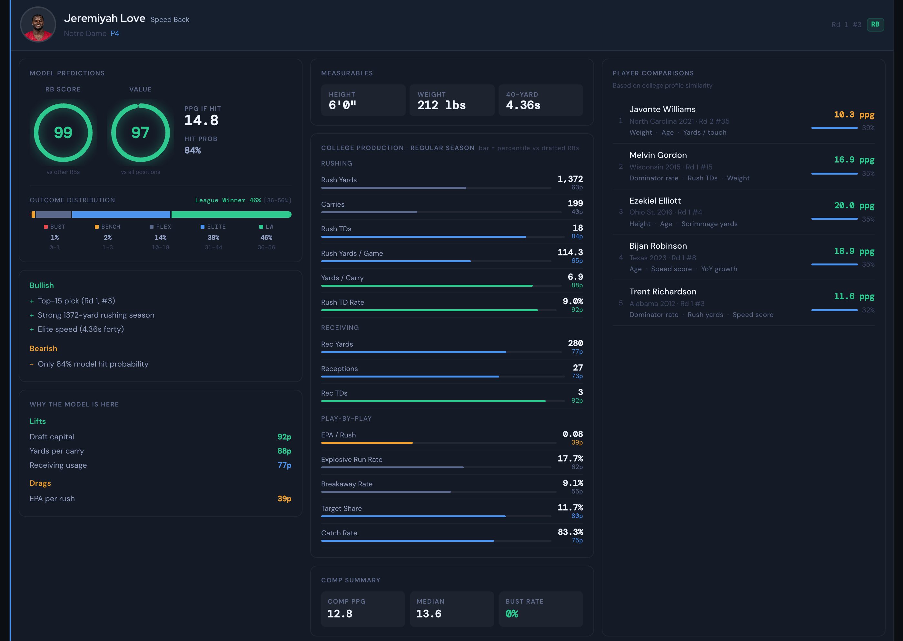
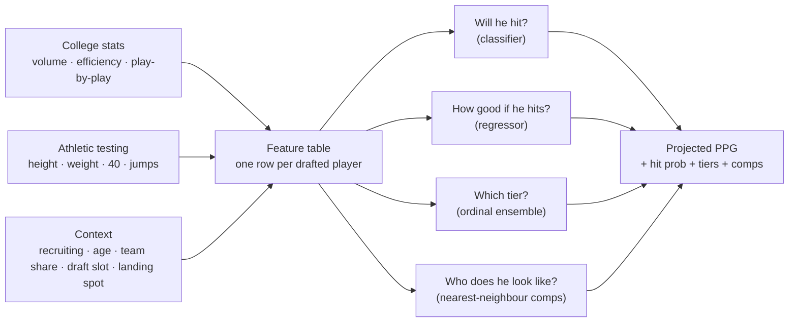
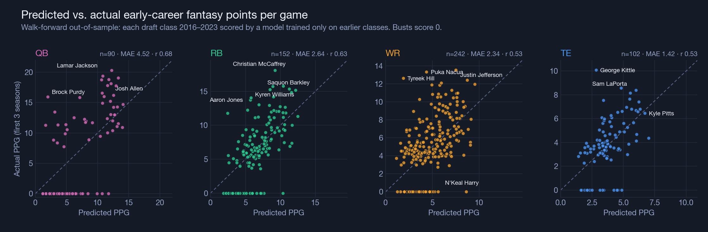
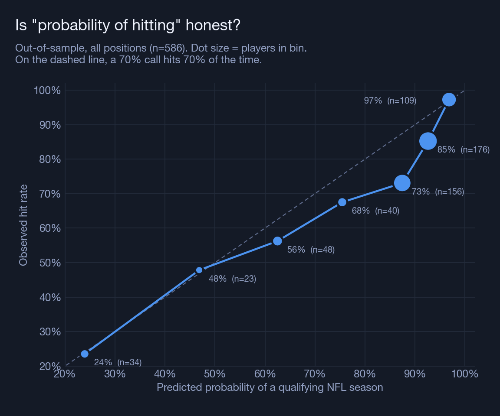
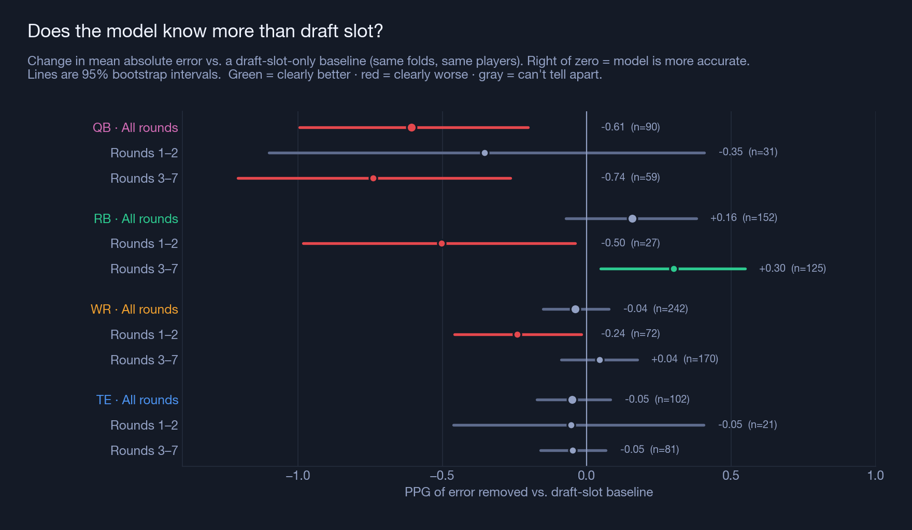

# DraftScout

**What will an NFL rookie score in fantasy football?** DraftScout projects every
drafted quarterback, running back, wide receiver and tight end from his college
profile, his athletic testing and where he was drafted. For each player it gives a
point estimate, the odds he busts, the shape of his outcome range, and the
historical players he most resembles, with the reasons each comparison was made.

**[→ Open the live site](https://wadefuller.github.io/nfl_prospect_eval/)**: 2021–2026
draft classes, 470+ prospects.



---

## Contents

- [What you get for each prospect](#what-you-get-for-each-prospect)
- [The 2026 class at a glance](#the-2026-class-at-a-glance)
- [How it works](#how-it-works)
- [How accurate is it?](#how-accurate-is-it)
- [Does it beat draft slot?](#does-it-beat-draft-slot)
- [Where it was right and where it was wrong](#where-it-was-right-and-where-it-was-wrong)
- [Limitations](#limitations)
- [Running it yourself](#running-it-yourself)

---

## What you get for each prospect



| On the card | What it means |
|---|---|
| **Projected PPG** | Expected half-PPR fantasy points per game over his first three NFL seasons. Busts count as 0. |
| **Hit probability** | Chance he has at least one *qualifying* season (6+ games of real fantasy production) in that window. |
| **Outcome distribution** | Odds of each of five tiers: *bust · bench · flex · elite · league winner*, with an 80% credible interval on each. |
| **Position score / Value** | Percentile within his position, and a cross-position score anchored to value over replacement. |
| **Player comparisons** | The five most similar historical prospects, and under each one the **three traits that matched most closely** (e.g. *Completion % · Pass TDs / game · Pass TDs*). |
| **Why the model is here** | The inputs pushing his projection up ("lifts") or down ("drags"), as percentiles against drafted players at his position. |
| **College production** | Volume, efficiency and play-by-play stats, each shown as a percentile against every drafted player at the position since the 2000s. |

## The 2026 class at a glance

Top two projections at each position (as of the latest site build):

| Pos | Player | School | Pick | Proj. PPG | Hit prob. | Most likely tier | Closest comps |
|---|---|---|---|---:|---:|---|---|
| QB | Fernando Mendoza | Indiana | 1.01 | 14.2 | 87% | elite | Andrew Luck, Andy Dalton, Dwayne Haskins |
| QB | Ty Simpson | Alabama | 1.13 | 9.9 | 82% | flex | Kenny Pickett, Jimmy Clausen, Geno Smith |
| RB | Jeremiyah Love | Notre Dame | 1.03 | 12.5 | 84% | league winner | Javonte Williams, Melvin Gordon, Ezekiel Elliott |
| RB | Jadarian Price | Notre Dame | 1.32 | 9.2 | 81% | flex | James Cook, T.J. Yeldon, Zach Charbonnet |
| WR | Carnell Tate | Ohio State | 1.04 | 8.2 | 85% | elite | Tee Higgins, CeeDee Lamb, Jaylen Waddle |
| WR | Makai Lemon | USC | 1.20 | 7.7 | 86% | elite | Golden Tate, Sammy Watkins, Kendall Wright |
| TE | Kenyon Sadiq | Oregon | 1.16 | 6.7 | 94% | league winner | Noah Fant, Austin Seferian-Jenkins, Rob Gronkowski |
| TE | Eli Stowers | Vanderbilt | 2.54 | 6.1 | 94% | flex | Tyler Kroft, Evan Engram, Mike Gesicki |

PPG scales differ a lot by position. A league-winning tight end scores about what
a flex receiver does, so compare tiers and position scores across positions, not
raw PPG. The tier cutoffs, in half-PPR PPG:

| | bench | flex | elite | league winner |
|---|---|---|---|---|
| QB | > 0 | ≥ 10.2 | ≥ 13.9 | ≥ 16.2 |
| RB | > 0 | ≥ 5.7 | ≥ 9.8 | ≥ 12.5 |
| WR | > 0 | ≥ 4.4 | ≥ 7.6 | ≥ 9.8 |
| TE | > 0 | ≥ 3.3 | ≥ 5.5 | ≥ 6.8 |

## How it works



**1. The target.** For every WR/RB/QB/TE drafted since the early 2000s, take the
games-weighted average of his best two qualifying seasons (6+ games) within his
first three NFL seasons, in half-PPR points per game. Small samples are shrunk
toward the position average. A player who never qualifies scores **0**. That zero
is the point of the exercise: the model has to predict busts, not only how good the
hits are.

**2. The inputs.** About 55–65 features per position, grouped as:

| Group | Examples | Coverage |
|---|---|---|
| College production | best-season yards, TDs, yards per game, year-over-year growth | all years |
| Efficiency & role | dominator rate, team pass share, yards per carry / target / attempt | all years |
| Play-by-play | EPA per play, explosive-play rate, target share, sack rate | 2014+ |
| Athleticism | height, weight, 40, vertical, broad jump, speed score | combine attendees |
| Pedigree | 247Sports recruiting composite, age, conference tier | ~2005+ |
| Draft & landing | draft slot, slot vs. mock consensus, depth chart at the landing spot | all years / 2014+ |

Data sources that only exist from a given year (play-by-play from 2014, for
example) carry an availability flag. That way the model learns "no data" as its
own state instead of treating an older player as average.

**3. The models.** Four pieces are combined:

- **A hurdle model.** A gradient-boosted classifier estimates *P(hit)*. A second
  model, trained only on players who hit, estimates *how many PPG* they score. The
  projection is roughly the product of the two. For RB and TE the second model
  aims at a high quantile instead of the mean. Elite backs and tight ends are rare
  outliers, and a mean model pulls them back toward average (it projected Brock
  Bowers at 5.8 PPG; he scored 12.2).
- **An outcome-tier ensemble.** An XGBoost multiclass model and a Bayesian
  ordered-logit model (`rstanarm::stan_polr`) each predict the five tiers, and the
  two are averaged. Running the Bayesian model across its posterior draws gives the
  credible intervals.
- **Historical comps.** Each prospect is matched to past prospects drafted within
  ±40 picks of him, using a weighted, robust-scaled distance over measurables,
  production, profile and age. Yardage is normalised for era, and a missing stat
  never counts as a match. The three features with the smallest standardised gaps
  become the "why this comp" labels.
- **A blend.** The final number mixes the model and the comp-weighted average. The
  weights were chosen by walk-forward testing (below), and they differ by position:
  QB 50/50, TE 30/70, WR 60/40, RB 35/65 (model/comps).

## How accurate is it?

Every number below is **out-of-sample** and **walk-forward**. To score the 2019
class, the models, the comp pool and every tuning choice see only players drafted
through 2018. That is repeated for each class from 2016 through 2023, giving 586
players. The 2024–2026 classes have not finished their three-season window and are
excluded.



| Position | Players | Avg. miss (MAE, PPG) | Correlation | Rank correlation |
|---|---:|---:|---:|---:|
| QB | 90 | 4.52 | 0.68 | 0.64 |
| RB | 152 | 2.64 | 0.63 | 0.65 |
| WR | 242 | 2.36 | 0.53 | 0.54 |
| TE | 102 | 1.42 | 0.53 | 0.55 |

QB misses look large because QB scoring runs on a larger scale. A 4.5-PPG miss
on quarterbacks is about the same relative error as a 1.4-PPG miss on tight ends.

**The hit probabilities are honest at the extremes and a bit optimistic in the
middle.** When the model says below 50% or above 95%, the observed rates match.
Between 80% and 95% it is about 10 points too confident. That band is mostly
Day 2–3 picks with good college résumés, and roughly one in four of them still
busted.

<p align="center"></p>

## Does it beat draft slot?

Draft slot is the strongest single predictor of NFL success. NFL front offices have
already priced in most of what a college stat line shows. So the useful question is
whether the model adds anything beyond draft slot, not whether it beats a coin
flip.

To test that, a baseline was built that uses **only draft slot**: a smooth curve of
PPG against log(pick), fit on the same walk-forward folds. Both were scored on the
same players with the same actual outcomes:



| Position | Model MAE | Draft-slot-only MAE | Verdict |
|---|---:|---:|---|
| QB | 4.52 | **3.91** | draft slot is better |
| RB | **2.64** | 2.80 | model better overall; **clearly better on Day 3 picks** |
| WR | 2.36 | **2.30** | statistically tied |
| TE | 1.42 | **1.37** | statistically tied |

The honest summary:

- **For running backs taken in rounds 3–7, the model knows something the draft
  doesn't.** Its error is 0.30 PPG lower (95% CI 0.05–0.55, n = 125). Rhamondre
  Stevenson, Aaron Jones, Khalil Herbert and Tyler Allgeier all projected well
  above their draft slot, and all delivered.
- **For receivers and tight ends it roughly matches draft slot.** It doesn't lose
  accuracy, and it adds outcome tiers, comps and explanations that a draft-slot
  curve can't give.
- **For quarterbacks and for first- and second-round WR/RB, draft slot is more
  accurate.** The model overrates highly productive college passers drafted late,
  and the NFL's QB evaluation is hard to beat with box-score stats. Read the QB
  projections as context, not as an edge.

This comparison is reproducible: `23_draft_slot_baseline.R` and
`docs/make_readme_figures.py` (details under [running it yourself](#running-it-yourself)).

## Where it was right and where it was wrong

Out-of-sample, from the walk-forward test:

| | Player | Drafted | Projected | Actual | |
|---|---|---|---:|---:|---|
| ✅ | Rhamondre Stevenson (RB) | 2021 · Rd 4 #120 | 8.3 | 10.3 | draft slot alone said 5.8 |
| ✅ | Aaron Jones (RB) | 2017 · Rd 5 #182 | 6.9 | 13.0 | draft slot alone said 3.7 |
| ✅ | Saquon Barkley (RB) | 2018 · Rd 1 #2 | 12.2 | 15.2 | |
| ✅ | Kyle Pitts (TE) | 2021 · Rd 1 #4 | 6.7 | 6.5 | |
| ❌ | Tyreek Hill (WR) | 2016 · Rd 5 #165 | 1.8 | 12.6 | 5th-round return man from a Division II school |
| ❌ | Puka Nacua (WR) | 2023 · Rd 5 #177 | 4.2 | 13.3 | injury-shortened college career |
| ❌ | Brock Purdy (QB) | 2022 · Rd 7 #262 | 2.0 | 16.0 | Mr. Irrelevant |
| ❌ | N'Keal Harry (WR) | 2019 · Rd 1 #32 | 8.4 | 0.0 | first-round bust |
| ❌ | Royce Freeman (RB) | 2018 · Rd 3 #71 | 11.6 | 7.4 | projected as a starter, settled as a committee back |

The misses fit a pattern. Late-round hits caused by **opportunity** (an injury
ahead of them on the depth chart, a scheme fit) aren't visible in college data.

## Limitations

- **It's a post-draft tool.** Draft slot is an input. Using it before the draft
  would mean substituting a mock-draft slot, and that hasn't been evaluated.
- **Small samples.** Each draft class adds only 10–30 players per position. Year-to-year
  swings in accuracy are mostly noise, and differences under ~0.1 PPG don't mean anything.
- **The early-career window.** The target covers the first three seasons, so late
  bloomers (and the 2024–2026 classes) aren't fully judged yet.
- **Upstream data gaps.** College stats come from public sources (`cfbfastR`,
  `nflreadr`). FCS players, transfers and pre-2014 seasons have patchier coverage,
  and name matching across sources is imperfect.
- **The WR/RB comp blend.** The final model/comp blend for WR and RB was tuned on
  recent classes and isn't part of the walk-forward numbers above. The WR/RB rows
  report the hurdle + tier ensemble. The QB/TE rows include the comp blend, with
  comps rebuilt inside each fold.

## Running it yourself

<details>
<summary><b>Pipeline, website and repo layout</b></summary>

### Requirements

- **R** with `tidyverse`, `tidymodels`, `xgboost`, `rstanarm`, `nflreadr`, `cfbfastR`, `jsonlite`
- A free [CollegeFootballData](https://collegefootballdata.com/key) API key in `~/.Renviron` as `CFBD_API_KEY`
- **Node 20+** for the website; **Python 3 + pandas + matplotlib** only to rebuild README figures

### Pipeline

```bash
./run_pipeline.sh              # full rebuild: data → features → models → scores → website JSON
./run_pipeline.sh score-only   # rescore with existing models
./run_pipeline.sh data-only    # refresh data caches only
```

Evaluation:

```bash
Rscript 11_temporal_cv.R          # walk-forward CV, WR/RB
Rscript 11b_temporal_cv_qb_te.R   # walk-forward CV, QB/TE (per-fold comp refit)
Rscript 20_bucket_cv.R            # outcome-tier CV
Rscript 23_draft_slot_baseline.R  # draft-slot-only baseline
python3 docs/make_readme_figures.py
```

### Website

```bash
cd website
npm install
npm run dev     # http://localhost:5173/
npm run build   # type-check + production build
```

The site is static React + TypeScript + Vite and reads JSON from `website/public/data/`.
It is regenerated by `Rscript export_website_data.R`, so don't edit those files by hand.
Pushing to `main` deploys to GitHub Pages.

### Layout

```text
01_build_targets.R            NFL outcome target (early-career half-PPR PPG)
02*_build_*.R                 College, play-by-play, combine, recruiting, landing-spot, mock features
03*_merge_*.R                 Per-position training tables
04*/05*_model_*.R             Hurdle model: hit classifier + production regressor
19*_train_ordinal_*.R         Outcome-tier ensemble (XGBoost + Bayesian ordered logit)
08_player_comps.R             Historical comps + "why this comp" reasons
07*_score_*.R                 Score every class 2021–2026
11*/20/23_*.R                 Walk-forward evaluation and baselines
export_*.R                    JSON for the website
functions/                    Feature specs (single source of truth) and shared helpers
website/                      React front end
docs/                         README figures and the script that builds them
```

For model internals, train/score parity rules and known data quirks, see
[MODEL_CONTEXT.md](MODEL_CONTEXT.md).

</details>

## Data & credits

NFL draft, combine, roster and fantasy data from [nflverse](https://nflverse.nflverse.com/)
(`nflreadr`). College stats and play-by-play from [`cfbfastR`](https://cfbfastr.sportsdataverse.org/)
and the [CollegeFootballData API](https://collegefootballdata.com/). Recruiting
composites from 247Sports via `cfbfastR`. Mock-draft history from JackLich10's
ESPN consensus archive and WalterFootball. Headshots from NFL.com.

This is an independent hobby project and isn't affiliated with the NFL or any team.
